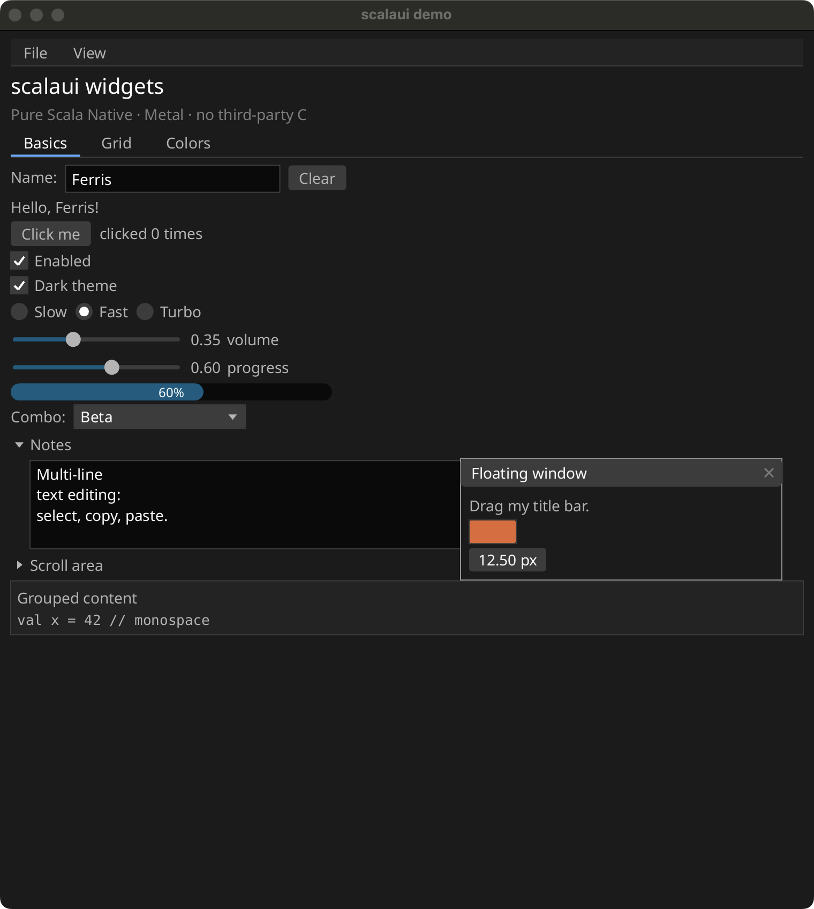

# scalaui

Cross-platform desktop application toolkit for **Scala Native** with **no third-party C libraries**.
The goal is to build apps like [PhotoCraft](https://github.com/storytold/photocraft) and
[WordCraft](https://github.com/storytold/wordcraft) in Scala. Platform backends talk to the OS directly
(Cocoa + Metal, Win32, the X11 wire protocol), so no `libX11`, GTK, SDL or zlib is linked.



## Rust stack → scalaui module

| Rust crate(s)                                 | Module      | Status |
|-----------------------------------------------|-------------|--------|
| kurbo                                         | `geom`      | done |
| miniz_oxide / flate2                          | `deflate`   | pure-Scala zlib (inflate + deflate), CRC-32, Adler-32 |
| color                                         | `color`     | sRGB, premultiplied blending, HSV |
| cms (lcms2)                                   | `cms`       | ICC v2/v4 parser (matrix/TRC, gray, lut8/lut16/mAB with tetrahedral CLUT, Lab/XYZ PCS), Bradford, 4 intents + BPC, `Transform` over RGBA8/float, built-in sRGB/Display P3/Adobe RGB/linear profiles, profile writer; verified vs littleCMS; PNG/JPEG/WebP profile extraction (`Image.iccProfile`), `ColorManagement.convert` in `imaging` |
| image-ops (compose/algo)                      | `imaging`   | 16 blend modes, Gaussian blur, color adjustments/curves/levels, Lanczos resize, rotate/flip/crop, histogram |
| vello_cpu / tiny-skia                         | `raster`    | CPU path rasterizer: fills, strokes, gradients (layers/filters todo) |
| image, zune-jpeg                              | `codecs`    | PNG, JPEG (read baseline + progressive, write baseline), BMP, GIF (animated), TIFF, WebP (lossy + lossless decode, animation, lossless encode); verified against ImageMagick/libwebp/libjpeg fixtures |
| skrifa, wuff                                  | `font`      | TrueType/glyf parser, cmap, names/styles, font families, system font scan, bundled Noto Sans (4 styles) + Hack; CFF (OpenType) outlines; WOFF 1.0 + WOFF2 (pure-Scala Brotli in `brotli`) |
| harfrust                                      | `shaping`   | OpenType shaping: GSUB 1-8, GPOS 1-8, normalization, per-character font fallback; Arabic joining, Indic (9 scripts), USE (Sinhala, Tibetan, Javanese, ...), Khmer, Myanmar, Thai/Lao, Hangul; vertical (TTB) shaping: `vert`/`vrt2`/`vkna`, vmtx/VORG, vertical GPOS; output verified against HarfBuzz on ~2500 golden cases (horizontal and `--direction=ttb`) |
| unicode-bidi, unicode-segmentation, unicode-linebreak, unicode-script, icu normalizer | `unicode` | UAX #9 bidi, #29 grapheme/word, #14 line breaking, scripts, NFC/NFD, UAX #50 vertical orientation, Zawgyi detection and Zawgyi-to-Unicode conversion (ports of Google's myanmar-tools, Apache-2.0); generated tables, official conformance tests pass |
| parley                                        | `text`      | bidi paragraph layout, UAX #14 line breaking, alignment, bidi-aware caret/hit-test/selection, rich multi-style layout, vertical layout (columns right to left, upright CJK, sideways Latin, rotated glyph rendering), glyph atlas |
| krilla                                        | `pdf`       | PDF writer: paths, gradients/patterns, groups, soft masks, blend modes, TrueType+CFF text, JPEG/alpha images, links, bookmarks, metadata |
| usvg / resvg                                  | `svg`       | SVG: CSS, text, gradients, patterns, clip/mask, markers, images, filters (93% of resvg's suite within tolerance) |
| quick-xml, zip, cfb (OPC/docx container) | `docx` | zip + xml package reader/writer (document model todo) |
| naga                                          | `shader`    | todo |
| wgpu                                          | `gpu`       | `Canvas` 2D renderer; Metal (macOS), Vulkan (Linux, Windows, and macOS via MoltenVK), Direct3D 11 (Windows, opt-in until run on real hardware) and a CPU `SoftwareBackend` fallback |
| winit                                         | `window`    | macOS (Cocoa), Windows (Win32), Linux/BSD (X11 over a Unix socket) |
| rfd                                           | `dialogs`   | macOS and Windows native dialogs; `ui.FileDialog` in-app picker for Linux |
| arboard                                       | `clipboard` | macOS, Windows and X11 (selection protocol) text |
| egui / eframe                                 | `ui`        | immediate-mode widgets (text and code editor with undo, line numbers and scrolling, virtual list, table, tree, plot, splitters, context menus, date picker, search combo, reorder list, Tab focus traversal and shortcuts, drag-and-drop, panels, animation, shadows, disabled state), `App` runner, snapshot test harness |

Existing libraries are used instead of reimplementing: scala-xml (parse with `ConstructingParser`; the SAX loader does not
link on Native), jsoniter-scala (json), `java.util.zip` (zip containers, see `docx`).

## Build and test

sbt 2 with sbt-scala-native:

```sh
sbt test                  # all unit tests (one project at a time is more reliable: sbt ui/test)
sbt examples/nativeLink   # widget gallery, canvas demo and image viewer
```

Scala Native test processes print nothing to sbt; failures are appended to `target/test-failures.log`
by `scalaui.testkit.LoggedSuite`.

## Targets

Everything builds with sbt. Release-mode binaries matter: the CPU renderer is ~10x slower in debug builds, so use
`set examples/nativeConfig ~= (_.withMode(scala.scalanative.build.Mode.releaseFast()))` (or set it in `build.sbt`).
Windows and Linux binaries are built on their own OS (see the CI matrix).

## Demos

```sh
BIN=target/out/native0.5/scala-3.9.0/scalaui-examples/scalaui-examples
$BIN                   # widget gallery
$BIN canvas            # raw 2D renderer
$BIN viewer photo.jpg  # image viewer: PNG/JPEG decode, wheel zoom, drag pan
SCALAUI_SOFTWARE=1 $BIN   # force the CPU renderer on macOS
SCALAUI_DEBUG=1 $BIN      # print per-frame timings to stderr
```

## Quick look

```scala
import scalaui.ui.*

@main def hello(): Unit =
  val name = Var("world")
  val count = Var(0)
  App.run("hello") { ui =>
    ui.heading("Hello")
    ui.horizontal { h => h.label("Name:"); h.textEdit(name) }
    if ui.button(s"Hi ${name.value}").clicked then count.value += 1
    ui.label(s"clicked ${count.value} times")
  }
```

## Platform notes

- **Windows accessibility**: `scalaui_uia.c` implements the UI Automation provider interfaces (window root, children with names,
  control types, bounds, states, Invoke/Toggle/Value/RangeValue patterns) in C, because UIA calls providers from RPC threads
  the Scala runtime does not know. Checked with Wine's UIA client (`tools/uia_client.cpp`): the tree, names, control types and
  bounding rectangles come through; pattern invocation could not be exercised (Wine stubs `GetCurrentPattern`). Text fields add
  TextPattern/ValuePattern (compile-checked with mingw only).
- **Wayland**: `WaylandWindow` speaks the protocol directly (xdg-shell, wl_shm, seat, data device for clipboard and
  drag-and-drop, server-side decorations, fractional scaling, cursor-shape, text-input-v3); keys use the compositor's XKB
  keymap (`XkbKeymap`, keysym names from `tools/gen_keysyms.py`). Used when `WAYLAND_DISPLAY` is set (`SCALAUI_X11=1` forces X11).
  Verified in an Ubuntu container against headless sway 1.9 (wlroots) and, for window/render/HiDPI only, weston 13 (headless):
  `WaylandSuite` and `WaylandE2ESuite` (window tests; grim screenshots equal the presented pixels exactly at scale 1, 1.5 and 2,
  resize, fullscreen, title, server-side decorations, compositor close, wtype keyboard incl. modifiers/repeat/non-US keymaps,
  virtual-pointer motion/buttons/wheel, clipboard both ways incl. 3 MB payloads), `tools/wayland_test.sh` (the demo on the Vulkan
  backend over lavapipe matches the software backend to within 9 pixels), `tools/wayland_dnd_test.sh` (file drop from a second
  client) and text-input-v3 against a scripted input-method-v2 client (`tools/wl_input_method.py`). Not verified: GNOME/KDE
  (Mutter and KWin, real GPUs, real input devices), minimize (sway ignores it), and there is no client-side decoration
  fallback, so compositors without xdg-decoration (GNOME, weston's desktop shell) show an undecorated window.
- **Linux accessibility**: `AtSpi` implements the AT-SPI2 protocol over a pure-Scala D-Bus client (`DBus`), so Orca and other
  screen readers see the widget tree, states, bounds and press actions; text fields implement `Text` (caret, selection,
  boundaries, extents, text-changed/caret-moved signals) and `EditableText`. `tools/atspi_test.sh` checks it against libatspi
  (python-gi) inside the Linux test container.
- **X11 input methods**: `Xim` is a client of the X Input Method protocol (no libX11): server discovery through `XMODIFIERS`/`XIM_SERVERS`,
  on-the-spot preedit callbacks with over-the-spot fallback, Compound Text and UTF-8, synchronous and trigger-key event flows. Verified
  against `ibus-daemon --xim` with the m17n vi-telex engine and against `tools/xim_server.py` (a protocol-level test server) in the
  Linux container (`XimSuite`).
- **GPU**: `GpuBackend.create` picks Metal on macOS, Vulkan on Linux/Windows, falling back to software when no driver
  loads. The Vulkan backend loads the system loader at run time (nothing linked), renders with 4x MSAA into an offscreen
  image and hands the pixels to `Window.present`, so it needs no window-system integration and works with the pure-Scala
  X11 client. Struct layouts come from `tools/gen_vk_layout.py`, SPIR-V from `tools/gen_shaders.sh`. It is tested against
  the software renderer (`VulkanSuite`, MoltenVK on macOS) and a Windows build runs it under Wine. `D3D12Backend` (Windows,
  hand-written COM vtables, flip-model swap chain, HLSL via d3dcompiler) is **unverified on real hardware**: it runs the demo
  under Wine's vkd3d on MoltenVK with output matching the software renderer, but has never run on a Windows GPU, so Windows
  tries Vulkan first, then D3D12, then D3D11. Force a backend with
  `SCALAUI_BACKEND=vulkan|d3d12|d3d11|metal|software`. Windows cross-build from macOS: `SCALAUI_WIN_CROSS=<mingw sysroot> sbt --server examples/nativeLink`.
- **macOS**: Cocoa/Metal are reached through the Objective-C runtime; frameworks are `dlopen`ed, so no
  `-framework` flags are needed. Scala Native cannot pass structs by value, so the few calls that do go
  through a first-party C shim (`modules/window/src/main/resources/scala-native/scalaui_objc.c`, system
  headers only, guarded by `#ifdef __APPLE__`). The shim also defines `ScaluiView`, an `NSView` subclass that implements
  `NSTextInputClient` (IME, dead keys, emoji picker), file drag-and-drop and cursor rects. Window features: cursor icons,
  system theme + `ThemeChanged`, blocking `waitEvents`, fullscreen/min-size/always-on-top/position/icon, and a
  VoiceOver accessibility tree (`Window.setAccessibility`, built automatically by the UI widgets). Windows and X11 have
  equivalents for cursors, IME (Windows and, through XIM, X11), file drops, theme and window controls; they are type-checked but have
  not been run, and have no screen-reader bridge yet (except Linux, below). Native menu bars (`App.run(menuBar = ...)`; macOS and Windows, with
  a drawn fallback elsewhere), PNG clipboard images, `Platform.print`, tray icons, INCR clipboard transfers on X11, OpenType features per text span, visual caret
  movement in bidirectional text and offscreen `Layers` (opacity, blend mode, clip path, mask) round out the toolkit.
- **Windows**: Win32 with `StretchDIBits` presentation of the software renderer.
- **Damage rectangles**: `App` redraws and presents only the region that changed between frames (tile hashes of the draw output); every GPU backend and `Window.present` accept a dirty rectangle, with results identical to a full redraw. See `site/content/performance.md`.
- **Linux/BSD**: a small X11 client (handshake, `~/.Xauthority`, CreateWindow, PutImage, keymap) written
  against the protocol spec; works on Wayland through XWayland. There is no window-manager decoration
  handling beyond `WM_DELETE_WINDOW`.
- `java.util.zip` is **not** used anywhere: Scala Native implements it with zlib, which breaks sysroot
  cross-compiles. Use `scalaui.deflate.Zlib`.
